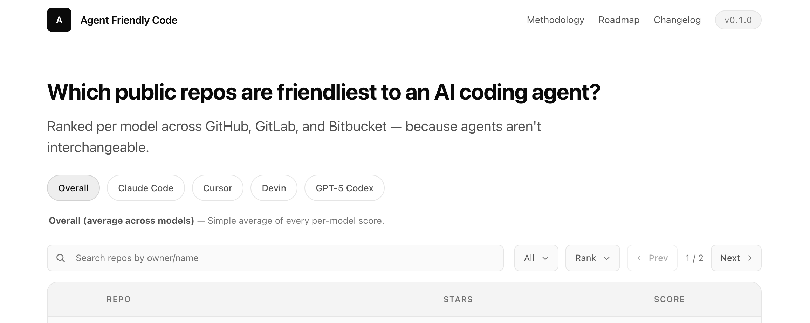
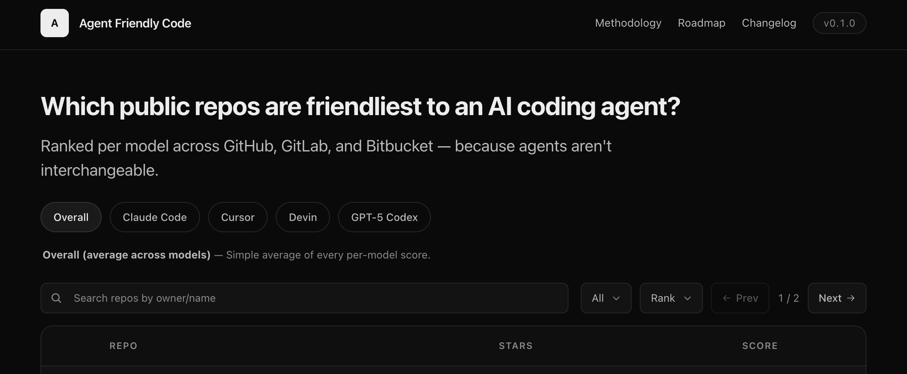

# Agent Friendly Code

[](https://agentfriendlycode.com/changelog)
[](./LICENSE)
[](https://nodejs.org)
[](https://github.com/sponsors/hsnice16)
[](https://agentfriendlycode.com)

**Scores how ready a repo is for AI coding agents, one score per agent, from static file checks.**

AI coding agents succeed far more often on some repos than others, and the difference is usually the repo: an `AGENTS.md`, tests, CI, a reproducible dev environment. Each agent reads different files, so a repo set up well for Claude Code may not be for Devin. Agent Friendly Code checks 17 signals, weights them per agent, and tells you which fixes would raise each agent's score most.



<details>
<summary>Dark mode</summary>



</details>

## Use it

| Where                                                                  | What you get                                                                                                     |
| ---------------------------------------------------------------------- | ---------------------------------------------------------------------------------------------------------------- |
| [agentfriendlycode.com](https://agentfriendlycode.com)                 | Ranked public repos from GitHub, GitLab and Bitbucket, with boards per agent, language and topic, and a page per check.          |
| [Live Score](https://agentfriendlycode.com/score)                      | Paste any public GitHub repo URL to score its current commit.                                                   |
| [Agent skill](https://github.com/hsnice16/agent-friendly-skill)        | `npx skills add hsnice16/agent-friendly-skill#v0` — scores the repo you are in, offline, and suggests a model. On [skills.sh](https://www.skills.sh/hsnice16/agent-friendly-skill/agent-friendly). |
| [GitHub Action](https://github.com/hsnice16/agent-friendly-action)     | Comments on each pull request with how it changes the score. Runs in your CI.                                    |
| Badge                                                                  | `https://agentfriendlycode.com/api/badge/<host>/<owner>/<name>.svg`, `?model=<id>` for one agent.               |

Scored agents: Claude Code, Cursor, Devin, Codex, Gemini CLI, Kimi Code CLI, Aider, OpenHands and Pi. Each agent's weights cite its published docs; [/methodology](https://agentfriendlycode.com/methodology) shows them.

### Public API

Read-only JSON, no key:

- `GET /api/score?host=<host>&repo=<owner>/<name>` — an indexed repo's score, signals and per-agent scores; `404 { "error": "not_indexed" }` otherwise.
- `GET /api/repos` — every ranked repo with its overall score.
- `GET /api/repo/<id>` — one repo by internal id.
- `GET /api/package/<registry>/<name>` — npm, PyPI or Cargo package → its source repo's score.

The skill and the Action vendor the scorer and never call the API.

## How it works

- **Ranked repos** are shallow-cloned (`--depth 1`), scored, and stored in a committed SQLite file. A GitHub Actions cron rescores them daily; a weekly audit flags seeds that were renamed, archived or removed.
- **Live Score** runs on Vercel, which has no `git`, so it rebuilds the file tree from the host API and fetches only the files a signal reads. A parity check asserts both paths give identical scores. Host tarballs are not used: they honour `export-ignore` and drop files.
- The scorer only reads files. It never runs code from a repo, never follows a symlink out of it, and reads at most 1 MiB per file.

## Limits

- Weights come from each agent's documentation, not yet from measured agent success. A benchmark harness that runs agents on real tasks is planned for 1.0.
- Static checks can be gamed, for example by an empty `AGENTS.md` (which scores as nearly missing).
- Live Score supports GitHub only. GitLab and Bitbucket work but are held back by their API limits.
- Maintainers can't opt out yet; that ships with the claim flow in 0.10. Until then, [open an issue](https://github.com/hsnice16/agent-friendly-code/issues).

Roadmap: [/roadmap](https://agentfriendlycode.com/roadmap). Released changes: [/changelog](https://agentfriendlycode.com/changelog).

## Prior art

Factory.ai Agent Readiness, `kodustech/agent-readiness`, `viktor-silakov/ai-ready` and similar tools scan one repo at a time with a single score. Agent Friendly Code is public, ranks across GitHub, GitLab and Bitbucket, and scores each agent separately. Benchmarks like SWE-Bench rank agents on fixed repos; this ranks repos per agent.

## Run locally

```bash
bun install            # Node ≥ 22 runs the app and scripts
bun run prepare-hooks  # once — pre-commit hooks
bun run dev            # http://localhost:3000, using the committed data/rank.db
bun run score https://github.com/vercel/next.js   # score one repo (URL or local path)
bun run test
```

`GITHUB_TOKEN` / `GITLAB_TOKEN` raise API rate limits. Both are optional locally; the deployed app needs a read-only `GITHUB_TOKEN`. See [.env.example](./.env.example).

Code layout, conventions and security notes: [AGENTS.md](./AGENTS.md). PR workflow: [CONTRIBUTING.md](./CONTRIBUTING.md).

## License

MIT — see [LICENSE](./LICENSE). If the project is useful to you, consider [sponsoring it](https://github.com/sponsors/hsnice16).
